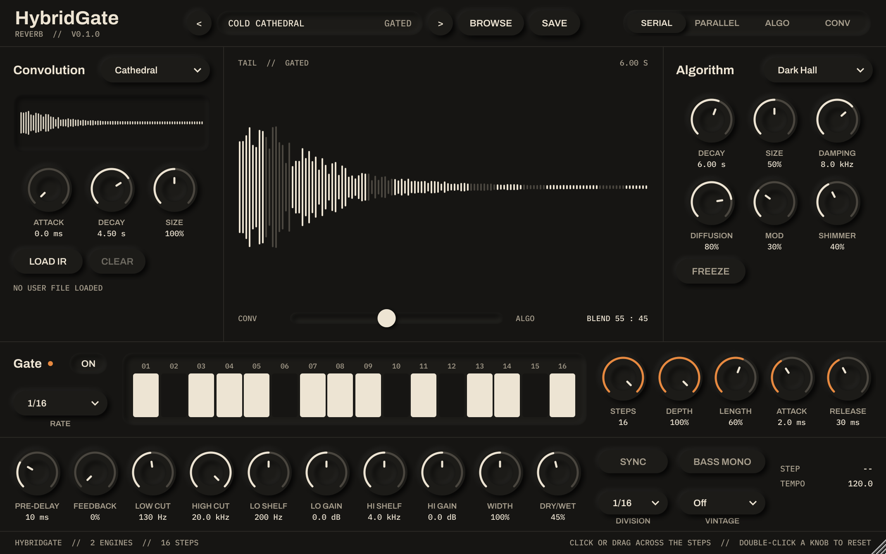

# HybridGate Reverb

A hybrid reverb effect plugin: a **convolution** engine and an **algorithmic** engine that can run in
series or in parallel, followed by wet-signal shaping and a tempo-synced **trance gate** on the wet output.

Built with [JUCE](https://juce.com) 9 and CMake.

| Format     | Windows | macOS (Intel + Apple Silicon) | Linux |
|------------|:-------:|:-----------------------------:|:-----:|
| VST3       | yes     | yes                           | yes   |
| AU         |         | yes                           |       |
| LV2        |         |                               | yes   |
| Standalone | yes     | yes                           | yes   |

VST3 covers FL Studio, Ableton Live, Cubase/Nuendo, Studio One, Reaper, Bitwig and Reason. AU covers
Logic Pro and GarageBand. Pro Tools (AAX) is not built: it needs Avid's SDK and signing tools.



The full user manual is in [docs/MANUAL.md](docs/MANUAL.md).

## Signal flow

```
in ──┬───────────────────────────────────────────────────────────── dry ──┐
     └─ pre-delay ─ [ convolution / algorithm ] ─ EQ ─ vintage ─ bass mono ─ width ─ TRANCE GATE ─ wet ─┴─ out
```

## Parameters

**Main** – Dry/Wet, Routing (Serial, Parallel, Algorithm, Convolution), Blend between the two engines,
Pre-Delay (ms or tempo-synced) with feedback.

**Convolution** – six built-in impulse responses (Room, Chamber, Hall, Cathedral, Plate, Reverse) that are
synthesised at load time, or your own WAV/AIFF/FLAC file via *Load IR...*. Attack, Decay and Size reshape
the impulse response.

**Algorithm** – Dark Hall, Plate, Shimmer, Tides and Echoes. Decay, Size, Damping, Diffusion, Modulation,
Shimmer amount and Freeze.

**EQ and output (wet only)** – low cut, high cut, low and high shelves, stereo width, bass mono, and a
"Vintage" sample-rate/bit-depth reducer.

**Trance gate (wet only)** – on/off, rate (1/4 to 1/32 including triplets), 1 to 16 steps, an on/off switch
per step, depth, step length, attack and release. It follows the host timeline while the transport plays
and keeps running at the last known tempo when the transport is stopped. Every step is an automatable
parameter.

## Getting a build

**Installers:** download the Windows setup `.exe` or the macOS `.pkg` from the
[latest release](https://github.com/sofusactura/Reverb-plugin/releases/latest). They are not code-signed yet:
on Windows choose *More info > Run anyway*, on macOS right-click the package and choose *Open*.

**Manual install:** every push also builds all three platforms on GitHub Actions. Open the **Actions** tab,
pick the latest run and download the artifact for your system.

Install the VST3 by copying the whole `HybridGate Reverb.vst3` folder to:

| System  | VST3 folder                                  |
|---------|----------------------------------------------|
| Windows | `C:\Program Files\Common Files\VST3\`        |
| macOS   | `~/Library/Audio/Plug-Ins/VST3/` (AU: `~/Library/Audio/Plug-Ins/Components/`) |
| Linux   | `~/.vst3/`                                   |

In **FL Studio**: *Options > Manage plugins > Find installed plugins*, then look for "HybridGate Reverb"
under Effects. The gate needs the tempo, so it follows the project tempo and song position automatically.

The macOS builds are not notarised. After downloading, clear the quarantine flag once:

```bash
xattr -dr com.apple.quarantine ~/Library/Audio/Plug-Ins/VST3/"HybridGate Reverb.vst3"
```

## Building it yourself

Requirements: CMake 3.22+, and Visual Studio 2022 (Windows), Xcode (macOS) or GCC/Clang (Linux).
JUCE is downloaded automatically during configuration.

```bash
cmake -S . -B build -DCMAKE_BUILD_TYPE=Release
```

```bash
cmake --build build --config Release --parallel
```

The plugins end up in `build/HybridGateReverb_artefacts/Release/`. Add `-DHGR_COPY_AFTER_BUILD=ON` to the
first command to install them into your plugin folders after each build.

On Linux install the JUCE dependencies first:

```bash
sudo apt-get install -y libasound2-dev libjack-jackd2-dev libfreetype-dev libfontconfig1-dev libx11-dev libxcomposite-dev libxcursor-dev libxext-dev libxinerama-dev libxrandr-dev libxrender-dev libxi-dev libgl1-mesa-dev
```

## Tests

`tests/OfflineTests.cpp` runs the real processor without a host: dry pass-through, every routing and
algorithm, every impulse response, every factory preset, extreme settings with random block sizes, freeze, gate timing, state
save/restore, sample rates from 22 kHz to 192 kHz and mono input.

```bash
ctest --test-dir build -C Release --output-on-failure
```

CI also runs [pluginval](https://github.com/Tracktion/pluginval) at strictness 10 on each platform.

## Layout

```
src/PluginProcessor.*      parameters, signal flow, state
src/PluginEditor.*         the one-page interface
src/ui/                    look and feel, knobs, step row, tail picture
src/Presets.*              factory presets
assets/fonts/              Archivo and IBM Plex Mono (SIL Open Font License)
docs/MANUAL.md             user manual
src/ConvolutionEngine.*    convolution reverb and background impulse-response builder
src/dsp/AlgoReverb.h       algorithmic reverb (feedback delay network)
src/dsp/IRGenerator.*      built-in impulse-response synthesis and shaping
src/dsp/TranceGate.h       tempo-synced step gate
tests/OfflineTests.cpp     headless tests
```

## Licensing note

JUCE is dual-licensed (AGPLv3 or the commercial JUCE licence). Check the
[JUCE licence terms](https://juce.com/get-juce/) before distributing this plugin as closed source.
