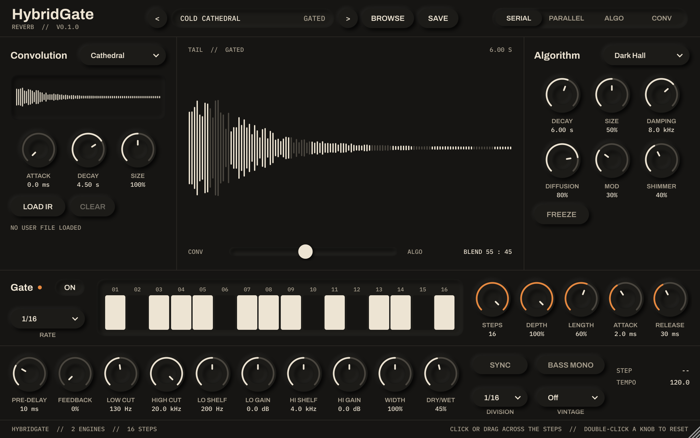

# HybridGate Reverb — User Manual

Version 0.1



HybridGate is a reverb with two engines and a rhythm gate. A **convolution** engine gives you the sound of a
space, an **algorithmic** engine gives you a tail you can stretch, modulate and freeze, and a **trance gate**
chops the reverb in time with your project. Only the reverb is gated; your dry sound always passes through
untouched.

## Contents

1. [Installing](#1-installing)
2. [Quick start](#2-quick-start)
3. [The interface](#3-the-interface)
4. [Presets](#4-presets)
5. [Routing and blend](#5-routing-and-blend)
6. [Convolution](#6-convolution)
7. [Algorithm](#7-algorithm)
8. [Trance gate](#8-trance-gate)
9. [Tone, space and output](#9-tone-space-and-output)
10. [Recipes](#10-recipes)
11. [Automation](#11-automation)
12. [Troubleshooting](#12-troubleshooting)

## 1. Installing

Copy the whole `HybridGate Reverb.vst3` folder into your VST3 folder, then rescan plugins in your DAW.

| System  | Folder |
|---------|--------|
| Windows | `C:\Program Files\Common Files\VST3\` |
| macOS   | `~/Library/Audio/Plug-Ins/VST3/` (Audio Unit: `~/Library/Audio/Plug-Ins/Components/`) |
| Linux   | `~/.vst3/` |

**FL Studio:** *Options > Manage plugins > Find installed plugins*. HybridGate Reverb appears under Effects.

**macOS:** the plugin is not notarised by Apple yet. Run this once after copying it, or macOS will refuse to load it:

```bash
xattr -dr com.apple.quarantine ~/Library/Audio/Plug-Ins/VST3/"HybridGate Reverb.vst3"
```

## 2. Quick start

1. Put HybridGate on a mixer track or a send.
2. Click **BROWSE** and pick a preset. *Big Hall* is a good plain reverb; *Cold Cathedral* shows the gate.
3. Set **DRY/WET** (bottom row, far right). On a send, turn it to 100%.
4. Press play. The gate follows your project tempo, and the orange marker shows the step that is playing.
5. Click steps in the **Gate** lane to open or close them.

## 3. The interface

Everything is on one page.

- **Top bar:** preset controls on the left, routing on the right.
- **Left column:** the convolution engine.
- **Centre:** a picture of the reverb tail, and the blend slider between the two engines. When the gate is on,
  the bars that fall on closed steps are dimmed.
- **Right column:** the algorithmic engine.
- **Gate lane:** the 16 steps and the gate's controls. Gate controls have orange knobs.
- **Bottom row:** pre-delay, EQ, width, dry/wet and character options.

Working the controls:

- **Knobs:** drag up or down. Double-click to reset.
- **Pills** such as FREEZE and BASS MONO are switches: pressed in means on.
- **Steps:** click to toggle, or click and drag across several steps to paint them.
- **Window size:** drag the bottom-right corner. The whole interface scales.

## 4. Presets

| Control | What it does |
|---------|--------------|
| **<** / **>** | Previous / next factory preset |
| Name display | The current preset and its category |
| **BROWSE** | Opens the preset menu: factory presets by category, your own presets under *User* |
| **SAVE** | Saves the current settings as your own preset |

Your presets are stored as `.hgrpreset` files in `Documents/HybridGate Reverb/Presets`. To share one, send the
file; to install one, drop it in that folder. *BROWSE > Open preset folder* takes you there.

A preset that uses your own impulse response remembers where that file is, not the audio itself. If the file
is moved, the preset falls back to the built-in hall.

### Factory presets

| Category | Preset | Character |
|----------|--------|-----------|
| Default | Init | Neutral starting point |
| Hall | Big Hall | Large, natural hall |
| Room | Small Room | Short, tight room |
| Room | Drum Chamber | Punchy chamber with mono lows |
| Plate | Vocal Plate | Bright plate with a little pre-delay |
| Ambient | Shimmer Heaven | Long tail that climbs in octaves |
| Ambient | Frozen Lake | Very long, wide and slowly moving |
| Ambient | Slow Bloom | Reverb that swells in after the sound |
| Gated | Cold Cathedral | Cathedral chopped in a classic trance rhythm |
| Gated | Trance Pump | Plate that opens on the off-beat |
| Gated | Gallop Gate | Shimmer in a galloping rhythm |
| Gated | Triplet Stutter | 12-step triplet pattern |
| Gated | Soft Tremor | Gentle, partial 1/8 pulse |
| FX | Dub Echoes | Sparse echoes with tempo-synced feedback |
| FX | Reverse Swell | Backwards build-up |
| FX | Lo-Fi Chamber | Dark, crunchy, narrow |

## 5. Routing and blend

The **routing** switch (top right) decides how the two engines are connected.

| Routing | Signal path | Good for |
|---------|-------------|----------|
| **SERIAL** | Convolution feeds the algorithm | The realism of a space with an extended, lush tail |
| **PARALLEL** | Both engines side by side | Layering two different reverbs |
| **ALGO** | Algorithm only | Plates, shimmer, freeze, lowest CPU use |
| **CONV** | Convolution only | Realistic rooms, your own impulse responses |

**BLEND** (the slider under the tail picture) fades between the engines. Fully left is convolution only, fully
right is algorithm only. In SERIAL, the right-hand side is the convolution *after* it has passed through the
algorithm. BLEND does nothing in ALGO or CONV routing.

## 6. Convolution

The drop-down picks the space: **Room, Chamber, Hall, Cathedral, Plate, Reverse**, or **User File**. The built-in
spaces are generated by the plugin, so there are no sample files to install.

| Control | Range | What it does |
|---------|-------|--------------|
| **ATTACK** | 0 – 500 ms | Fades the start of the reverb in. Higher values soften or remove the early slap |
| **DECAY** | 0.1 – 10 s | How long the space rings |
| **SIZE** | 50 – 200% | Smaller is tighter and brighter, larger is wider-spaced and darker |
| **LOAD IR** | | Loads your own impulse response (WAV, AIFF or FLAC) and switches to *User File* |
| **CLEAR** | | Forgets your file and returns to the built-in hall |

With your own file, DECAY shortens the recording and SIZE stretches it, which also changes its pitch. Set DECAY
to maximum (10 s) to hear the file exactly as recorded. Files longer than 20 seconds are cut at 20 seconds.

Changing these controls rebuilds the space in the background, so there is a brief, smooth crossfade rather
than an instant change.

## 7. Algorithm

| Type | Sound |
|------|-------|
| **Dark Hall** | Big and warm, highs fade quickly |
| **Plate** | Dense and bright from the first moment |
| **Shimmer** | Each repeat is shifted up an octave, for a rising, glassy tail |
| **Tides** | Slow, deep movement with a tone that drifts over time |
| **Echoes** | Sparse and grainy, you can hear individual repeats |

| Control | Range | What it does |
|---------|-------|--------------|
| **DECAY** | 0.2 – 30 s | Length of the tail |
| **SIZE** | 0 – 100% | Size of the virtual space. Changing it while sound plays bends the pitch, like tape |
| **DAMPING** | 500 Hz – 20 kHz | Where the highs start to fade. Lower is darker |
| **DIFFUSION** | 0 – 100% | Low values are grainy and echo-like, high values are smooth |
| **MOD** | 0 – 100% | Chorus-like movement inside the tail |
| **SHIMMER** | 0 – 100% | Amount of octave shifting. Only works with the Shimmer type |
| **FREEZE** | on / off | Holds the current tail forever and stops new sound entering |

## 8. Trance gate

The gate turns the reverb up and down in a repeating step pattern. It sits at the very end of the reverb path,
so everything wet is gated and nothing dry is.

| Control | Range | What it does |
|---------|-------|--------------|
| **ON** | on / off | Turns the gate on. The dot next to *Gate* glows orange |
| **RATE** | 1/4, 1/8, 1/8T, 1/16, 1/16T, 1/32 | Length of one step. T means triplet |
| **Steps 01–16** | open / closed | Light steps let the reverb through |
| **STEPS** | 1 – 16 | How many steps play before the pattern repeats. Unused steps are dimmed |
| **DEPTH** | 0 – 100% | How much closed steps are turned down. 100% is silence, 50% is a gentle pulse |
| **LENGTH** | 5 – 100% | How much of each open step stays open. At 100%, neighbouring open steps join together |
| **ATTACK** | 0.1 – 50 ms | How quickly the gate opens |
| **RELEASE** | 1 – 500 ms | How quickly the gate closes. Longer values give a softer, pumping feel |

**Timing.** While your project plays, the gate locks to the tempo and the song position, so step 01 always
lands at the same place in the bar. When the transport is stopped the gate keeps running at the last known
tempo, so you can still hear it while playing notes by hand.

**Pattern length.** 16 steps at 1/16 is one bar. For triplet rates, set STEPS to 12 for one bar of 1/16T or 6
for one bar of 1/8T.

## 9. Tone, space and output

All of these affect the reverb only.

| Control | Range | What it does |
|---------|-------|--------------|
| **PRE-DELAY** | 0 – 500 ms | Gap before the reverb starts. Keeps vocals and drums clear |
| **SYNC** + **DIVISION** | 1/64 – 1/2 | Sets the pre-delay to a note length instead (the PRE-DELAY knob is then ignored) |
| **FEEDBACK** | 0 – 90% | Repeats the pre-delay, turning it into an echo that feeds the reverb |
| **LOW CUT** | 20 Hz – 1 kHz | Removes lows from the reverb. Fully left is off |
| **HIGH CUT** | 1 – 20 kHz | Removes highs from the reverb. Fully right is off |
| **LO SHELF** / **LO GAIN** | 40 Hz – 1 kHz, ±12 dB | Boosts or cuts everything below the chosen frequency |
| **HI SHELF** / **HI GAIN** | 1 – 16 kHz, ±12 dB | Boosts or cuts everything above the chosen frequency |
| **WIDTH** | 0 – 200% | 0% is mono, 100% is unchanged, 200% is extra wide |
| **BASS MONO** | on / off | Makes the reverb mono below about 180 Hz, for a solid low end |
| **VINTAGE** | Off, Subtle, Old, Older, Extreme | Lowers the sample rate and bit depth for a gritty, old-hardware sound |
| **DRY/WET** | 0 – 100% | Balance between the original sound and the reverb |

The **STEP** and **TEMPO** readouts on the right show the gate step that is playing and the tempo the plugin
is receiving from the host.

## 10. Recipes

**Classic trance gate on a pad.** Load *Cold Cathedral*. Raise DRY/WET until the reverb is as loud as the pad.
For a harder chop lower RELEASE; for more pump raise it.

**Sidechain-style pump without a compressor.** Load *Trance Pump*. The reverb is closed on every beat and opens
between them, leaving room for the kick.

**Clear vocal reverb.** Load *Vocal Plate*. Use it on a send at 100% DRY/WET, and raise LOW CUT until the mud
goes.

**Endless drone.** Choose ALGO routing and the Tides type, play a chord, then press FREEZE. Turn the gate on to
make the frozen chord rhythmic.

**Reverse build-up.** Load *Reverse Swell* and raise Convolution DECAY to lengthen the swell.

**Lo-fi space.** Set VINTAGE to Old or Older, pull HIGH CUT down to about 5 kHz and narrow WIDTH.

## 11. Automation

Every control can be automated from your DAW, including each of the 16 gate steps (*Gate Step 1* to
*Gate Step 16*). Automating step switches lets a pattern change through a song.

Routing, type and space choices switch immediately and can click if changed while loud reverb is ringing;
automate them in a quiet moment.

## 12. Troubleshooting

**I hear no reverb.** Check DRY/WET is above 0%. If the gate is on, check that some steps are open and DEPTH is
not hiding everything. In CONV routing with *User File* selected but no file loaded, the plugin uses the hall.

**The gate is out of time.** Check the TEMPO readout matches your project. The gate only locks to the bar
while the transport is playing.

**The reverb never stops.** FREEZE is on, or Algorithm DECAY is very long.

**It clicks when the gate closes.** Raise gate RELEASE to 10 ms or more.

**High CPU use.** Long convolution decays are the most expensive part. Shorten Convolution DECAY or use ALGO
routing.

**My own impulse response is missing after reopening a project.** The file was moved or renamed. Load it again
with LOAD IR.

**The plugin does not appear in my DAW.** Check that the whole `.vst3` folder is in the folder listed in
section 1, then rescan. On macOS, run the command from section 1.
